# UntrashOS on the Zyxel NAS542 — User Guide

This guide covers installing UntrashOS from the USB stick and every function of the
**Untrash Desk**, the web interface you use to run the NAS. Each screen is described with all of
its options. The tables list each option, its choices (the default is **bold**), and what it does.

> **About the screenshots.** The screenshots were taken on *emulated* hardware: the installer runs
> in its dry run (commands are shown, not executed), and the Desk runs in a test mode with example
> data. All names, addresses and files are examples (users `anna` and `ben`, network `192.0.2.x`,
> `*.example.net`).
>
> The guide is also built into UntrashOS: open **Manual** in the Desk, use the link on the sign-in
> page, or the link at the top of the installer. All of them offer this guide as a PDF as well.

## Contents

1. [Installation](#1-installation)
2. [First start and sign-in](#2-first-start-and-sign-in)
3. [Working with the Desk](#3-working-with-the-desk)
4. [Files](#4-files)
5. [Shares](#5-shares)
6. [Storage](#6-storage)
7. [Users and groups](#7-users-and-groups)
8. [Network](#8-network)
9. [Settings](#9-settings)
10. [Ad filter](#10-ad-filter)
11. [Media server and channels](#11-media-server-and-channels)
12. [Cloud](#12-cloud)
13. [Downloads](#13-downloads)
14. [Backup](#14-backup)
15. [Updates](#15-updates)
16. [Status, logs and system tools](#16-status-logs-and-system-tools)
17. [Working as a normal user](#17-working-as-a-normal-user)
18. [Back to the Zyxel firmware](#18-back-to-the-zyxel-firmware)

---

## 1. Installation

### 1.1 What you need

- A Zyxel NAS542 running the original Zyxel firmware, with its disks in place.
- A USB stick of at least 4 GB (the image is 3.4 GB). **It is erased.**
- A PC, tablet or phone with a web browser on the same network as the NAS.
- The UntrashOS stick image `untrash-stick-<version>.img`.

### 1.2 Write the stick

Write the image to the stick with any image writer (balenaEtcher, Raspberry Pi Imager, `dd`).
On Linux, the project script does the same with extra checks. Replace `/dev/sdX` with
your stick. Every byte on that device is overwritten:

```bash
sudo install/write-stick.sh untrash-stick-<version>.img /dev/sdX
```

The stick image is the same for every NAS542. Nothing on it is made for a particular device.
Everything that belongs to one NAS is created on that NAS during the first run. The stick then
holds that NAS's backup and is marked as used. **Use a freshly written stick for each NAS.**

### 1.3 First run under the Zyxel firmware

1. Switch the NAS off and plug the stick into a USB port of the NAS.
2. Switch the NAS on. While it starts, the Zyxel firmware runs the install script from the stick:
    1. It checks that the flash layout and the boot settings are those of a normal NAS542.
    2. It saves a **complete backup of the flash** to the stick, reads it back and compares it.
    3. It saves the **Zyxel configuration** (users, groups, shares, passwords) to the stick.
    4. It installs the small UntrashOS loader into the unused one of the two firmware slots and adds
       one call to the boot settings. The Zyxel firmware itself is not changed.
    5. It **switches the NAS off**.
3. Leave the stick in the NAS.

If any step fails, the script writes the backup back, leaves an `INSTALL_FAILED` marker on the stick
and switches the NAS off. The NAS then starts the Zyxel firmware as before.

### 1.4 Open the installer

Switch the NAS on again. The loader starts the installer from the stick. After a minute or two, open

**<http://untrash.local/>** in the browser. If your router does not resolve `.local` names,
try `http://untrash/` or the address your router lists for the NAS.  If another UntrashOS
device already uses the name, the installer answers as `http://untrash-2.local/` (then `-3`, …).

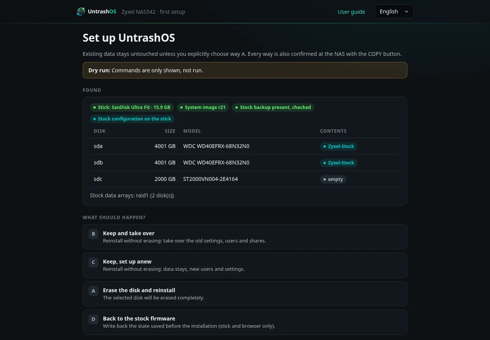

| Element | Meaning |
|---|---|
| **Stick** | Model and size of the installation stick. |
| **System image** | The UntrashOS version on the stick. *Missing* means the stick image is incomplete. |
| **Stock backup** | *present, checked*: the flash backup was read back and compared when it was made. *present (unchecked)*: the backup exists but was not compared. *No stock backup*: way D is not possible. |
| **Stock configuration on the stick** | The saved Zyxel users, groups and shares, needed for way B. |
| **Disk table** | Every disk with size, model and content: **Zyxel-Stock** (a disk of the Zyxel firmware), **empty**, **UntrashOS**, **RAID member** or **unknown**. |
| **Language** (top right) | English, Deutsch, Français. The installed system starts with the language chosen here. |
| **User guide** (top) | Opens this guide. |

### 1.5 The four ways

There are four ways. **Ways B and C keep all your data**. They change no partition and no RAID
array. UntrashOS is stored as a few files in the hidden folder `/.untrash` of an existing Zyxel
volume. Only **way A** erases a disk.

| Way | What happens | Data | Confirmation word |
|---|---|---|---|
| **B – Keep and take over** | New installation on a Zyxel volume. Users, groups, shares and SMB passwords of the Zyxel firmware are taken over on the first start. | kept | `KEEP` |
| **C – Keep, set up anew** | New installation on a Zyxel volume. A new `admin` password and a network name are set. Every top-level folder becomes a share for `admin`. The old users are not taken over. | kept | `KEEP` |
| **A – Erase the disk and reinstall** | The chosen disk is erased and gets its own UntrashOS layout (two system slots, state, swap, data area with btrfs). | **erased** on that disk | `DELETE <disk>`, e.g. `DELETE sdc` |
| **D – Back to the stock firmware** | Writes the Zyxel boot data back from the backup on the stick (see [section 18](#18-back-to-the-zyxel-firmware)). | kept | `STOCK` |

Choosing a way shows its **plan**, step by step. Nothing happens until you confirm:

1. Type the confirmation word shown in the yellow box and click **Start**.
2. **Press the COPY button on the front of the NAS within 60 seconds.** Without the button press,
   the installer stops and changes nothing.

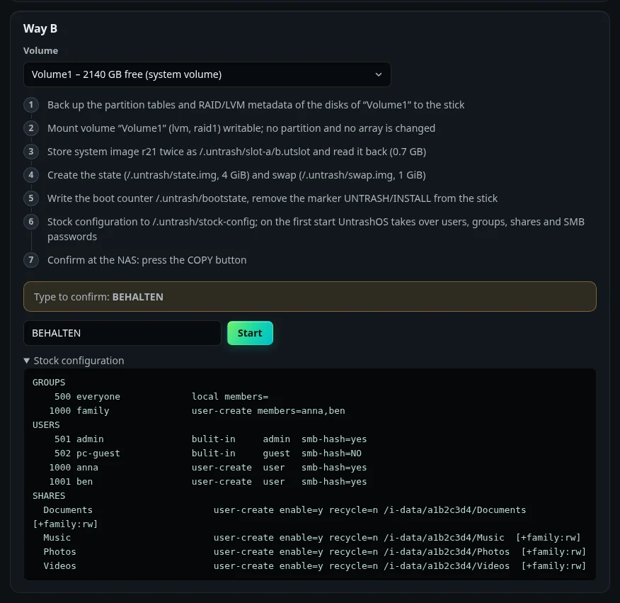

#### Way B options

| Option | Choices | Meaning |
|---|---|---|
| Volume | the Zyxel volumes, **system volume first** | Where the UntrashOS files go. The installer shows the free space. It needs room for two copies of the system image plus 5 GiB. |
| Stock configuration | (expandable) | Shows the groups, users and shares that will be taken over. |

#### Way C options

| Option | Choices | Meaning |
|---|---|---|
| Volume | as for way B | Where the UntrashOS files go. |
| Network name | text, default **untrash** | 1–15 letters, digits or hyphens. The NAS is reachable as `<name>.local`. |
| New password for admin | text | At least 8 characters. Used for the Desk, SMB and SSH. |
| Repeat password | text | Must match. |

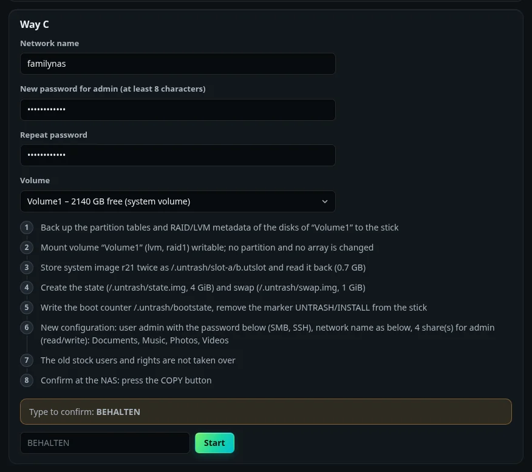

#### Way A options

| Option | Choices | Meaning |
|---|---|---|
| Disk | every disk with size, model and content | The disk to erase. It needs at least 16 GiB. The disk the installer itself runs from cannot be chosen. If the disk belongs to a Zyxel RAID array, the plan warns that the array loses a disk. |

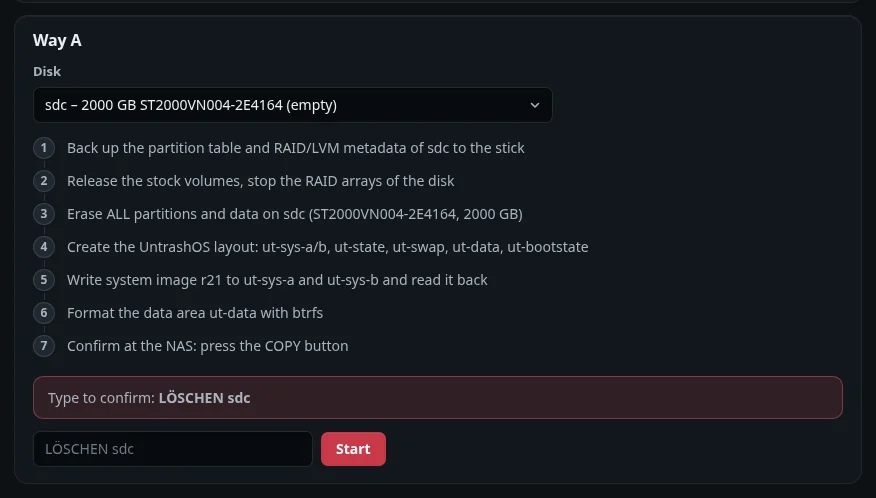

#### Way D options

| Option | Choices | Meaning |
|---|---|---|
| Backup | the completed installation backups on the stick, **newest first** | The state the NAS returns to. |

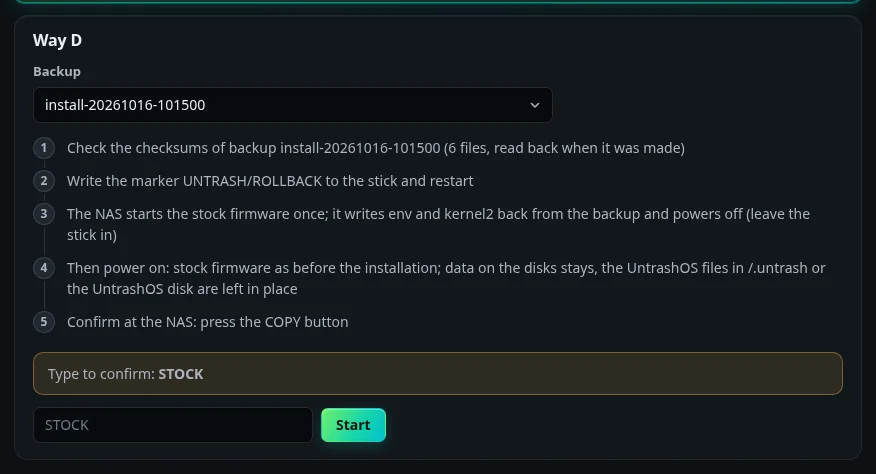

**The installer refuses to start** when a requirement is missing, and says why. Examples: no
stick or no system image, too little free space on the volume, an incomplete RAID array ("insert
all disks first"), a disk that already carries UntrashOS partitions while you choose way B or C.

### 1.6 Progress and restart

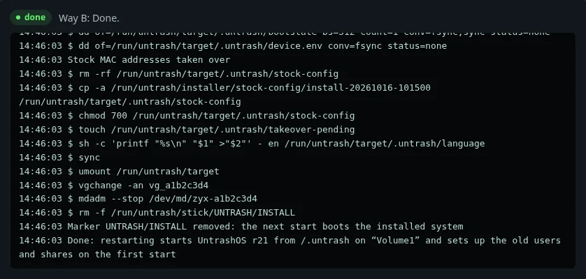

The **Progress** box shows the state (*ready*, *COPY button*, *running*, *done*, *error*) and logs
every step and command. Before anything is written, the partition tables and RAID/LVM metadata of
the affected disks are saved to the stick (`UNTRASH/disk-backup-…`). Every system image that is
written is read back and compared.

When the state is **done**, click **Restart**. The NAS starts the installed UntrashOS. You can
remove the stick afterwards. **Keep it:** it holds the backup for the way back to the Zyxel
firmware.

> The yellow *Dry run* box and `(DRY RUN)` in the screenshot exist only in the emulation used for
> this guide.

## 2. First start and sign-in

Open `http://<network name>.local/` (for example `http://untrash.local/`), or the address
of the NAS.  A NAS with the default name that finds `untrash` taken in the network becomes
`untrash-2` (then `untrash-3`, …) and keeps that name from then on; a name you chose, or the
name of the stock system (way B), is never changed.

**After way A** the NAS has no users yet. The first page asks for:

| Option | Meaning |
|---|---|
| Network name | Host name of the NAS (1–15 letters, digits, hyphens). |
| Password for admin | At least 8 characters. |
| Repeat password | Must match. |

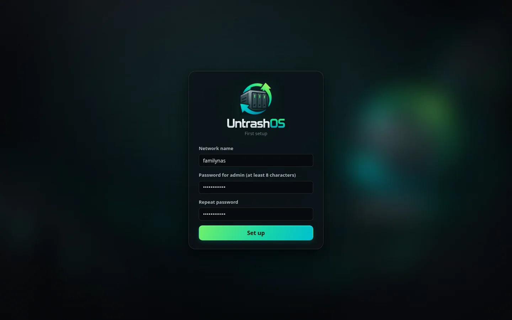

**After way B or C**, sign in. After way B, every user keeps the password from the Zyxel firmware.
After way C, use `admin` and the password you chose in the installer.

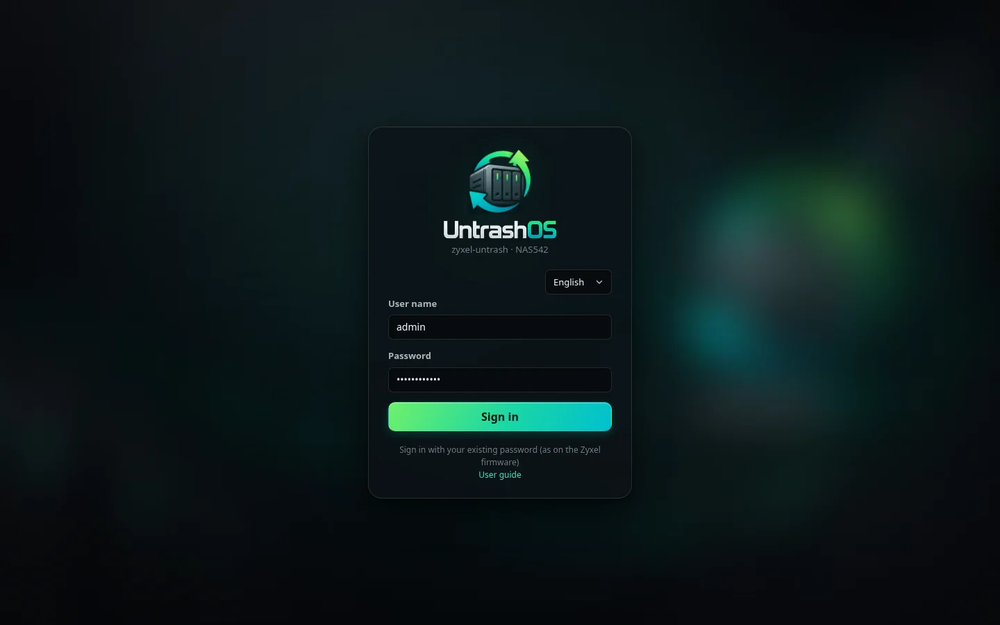

| Option | Meaning |
|---|---|
| Language | Language of this browser: English, Deutsch, Français. |
| User name, Password | Your account. Several wrong passwords in a row lock the sign-in for a while. |
| User guide | Opens this guide without signing in. |

## 3. Working with the Desk

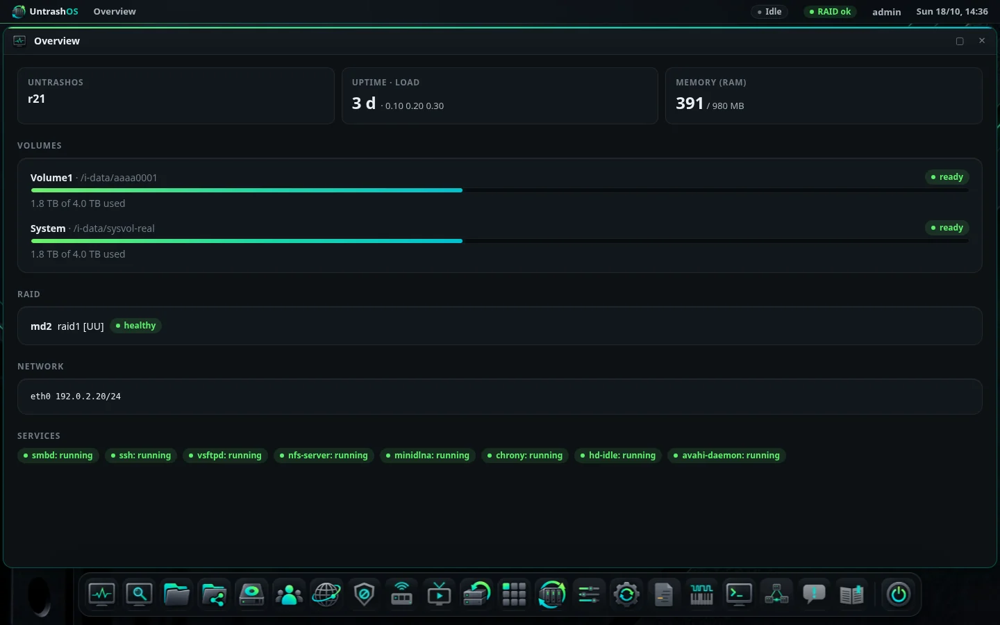

| Element | Meaning |
|---|---|
| **Top bar** | Name of the active window; current activity (for example a media scan, streams, a running backup or update); **RAID** state; your **user name** (click it to change the language of this browser or to sign out); date and time. |
| **Desktop icons** | The first apps, opened with a click. |
| **Dock** | All apps. Hover over an icon to see its name. The **power button** at the right end switches the NAS off or restarts it ([section 16](#16-status-logs-and-system-tools)). |
| **Windows** | Move them by the title bar and resize them at the edges and corners. **▢** maximizes, and so does a double click on the title bar. **✕** closes. Each window keeps its size in your browser. |

**Overview** shows the installed version, uptime and load, the memory in use, each volume with its
fill level, the RAID arrays and their health, the network addresses and the state of the main
services (SMB, SSH, FTP, NFS, media server, time, disk spin-down, mDNS).

Administrators see all apps. Normal users see **Files**, **Channels**, **Manual** and **My account**
([section 17](#17-working-as-a-normal-user)).

## 4. Files

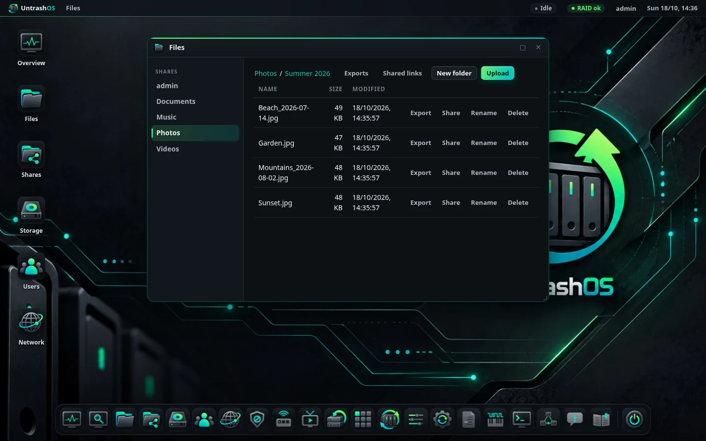

Pick a share on the left and click folders to open them. The path above the list leads back.
Shares whose volume is missing are listed under *Volume missing* and cannot be opened.

| Button | Meaning |
|---|---|
| **New folder** | Creates a folder in the current folder. |
| **Upload** | Uploads files from your device into the current folder. |
| **Exports** | Running and finished exports. |
| **Shared links** | Your download links with their expiry: **Copy** the address again or **Delete** the link. Administrators see the links of all users. |
| **Export** (per row) | Copies or converts a file or folder, see below. |
| **Share…** (per row) | Creates a download link, see below. |
| **As share** (per folder, admins only) | Makes the folder a share of its own ([section 5](#5-shares)). |
| **Rename**, **Delete** (per row) | Renames, or deletes permanently after a confirmation. (The recycle bin applies to deletions over the network, for example from Windows.) |

Clicking a file opens it:

| File type | Opens in |
|---|---|
| Photos (JPEG, PNG, GIF, WebP, BMP) | **Photo viewer** with *Back*, *Next*, *Download*. |
| Video and music (MP4, MKV, AVI, MP3, FLAC, …) | **Player**, which plays every media file of the folder as a playlist. For videos with several audio tracks you can choose the track. |
| PDF and text files | **Document viewer** with page navigation and zoom. |
| Everything else | Download. |

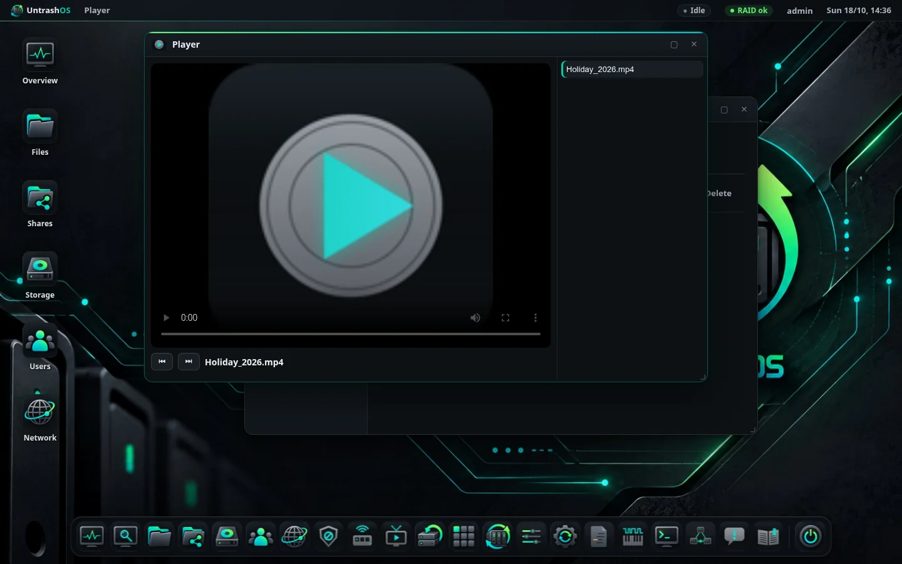

### Share link

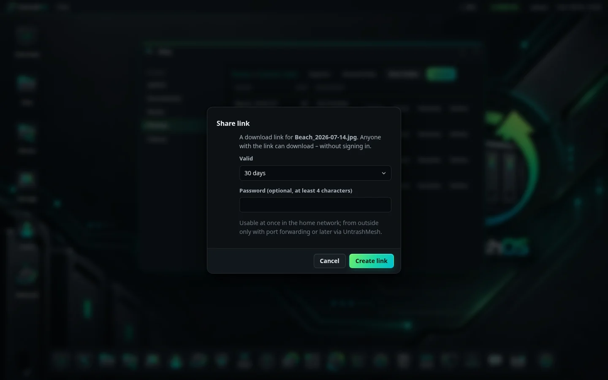

| Option | Choices | Meaning |
|---|---|---|
| Valid | 1 day, **7 days**, 30 days, 90 days | When the link stops working. |
| Password | optional, at least 4 characters | Asked before the download. |

Anyone with the link can download the file, or a folder as ZIP, without signing in. Links work in
the home network at once. From outside they need a port forwarding ([section 8](#8-network)).

### Export

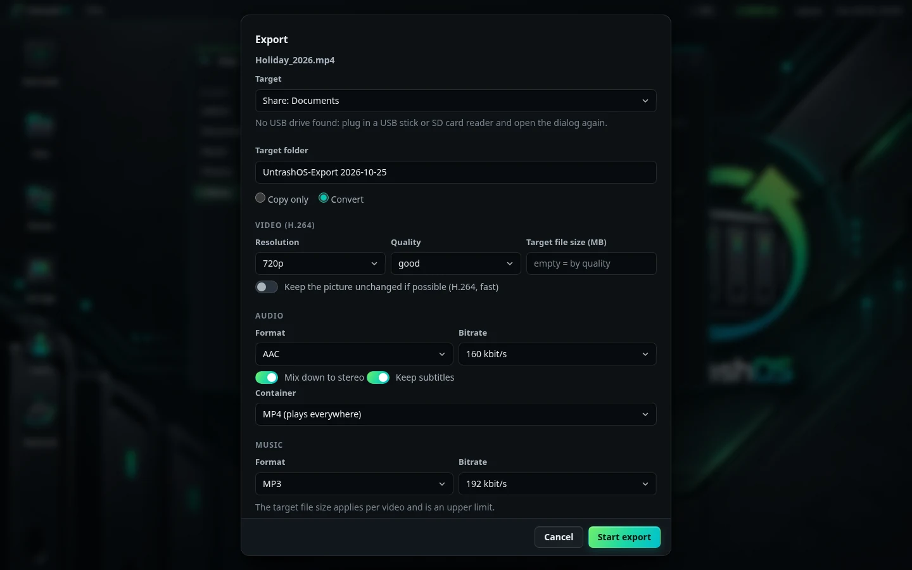

| Option | Choices | Meaning |
|---|---|---|
| Target | **USB/SD drives**, then every share | Where the copy goes. Plug in a USB stick or SD card reader and reopen the dialog to see it. |
| Target folder | default **UntrashOS-Export <date>** | Folder created at the target. |
| Mode | **Copy only**, Convert | *Copy only* copies 1:1. *Convert* recodes video and music as set below; other files are copied. |
| Video: Resolution | as original, 1080p, **720p**, 480p, 360p | Maximum picture height. |
| Video: Quality | high, **good**, medium, small | Picture quality versus file size. |
| Video: Target file size (MB) | empty = by quality | Upper limit per video; overrides the quality. |
| Keep the picture unchanged if possible | **off**, on | Keeps H.264 video as it is and only converts the sound (fast). |
| Audio: Format | **AAC**, MP3, Opus, unchanged | Sound of videos. |
| Audio: Bitrate | 96, 128, **160**, 192, 256 kbit/s | Sound quality. |
| Mix down to stereo | **on**, off | Turns surround sound into stereo. |
| Keep subtitles | **on**, off | Keeps subtitle tracks. |
| Container | **MP4 (plays everywhere)**, MKV (all subtitles) | File format of the video. |
| Music: Format | **MP3**, AAC, Opus, FLAC, unchanged | Format for music files. |
| Music: Bitrate | 128, **192**, 256, 320 kbit/s | Quality for music. |

Converting runs in the background and is slow on the NAS, which has no hardware encoder: a feature
film in 720p takes several hours. The top bar and **Exports** show the progress.

## 5. Shares

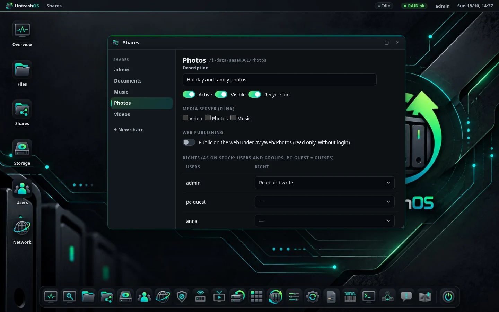

Choose a share on the left. Disabled shares are marked *(off)*.

| Option | Choices | Meaning |
|---|---|---|
| Description | text | Shown in the network. |
| Active | **on**, off | Off hides the share from the network; the folder stays. |
| Visible | **on**, off | Off hides the share from network browsing; it can still be opened by name. |
| Recycle bin | on, off | Deleted files go to a `recycle` folder of the share ([section 9](#9-settings), *Recycle bin*). |
| Media server (DLNA) | Video, Photos, Music | Which media types the media server publishes from this share. |
| Web Publishing | **off**, on | Readable on the web under `/MyWeb/<share>`, without login and read only. Needs *Web Publishing* in Settings → Services. |
| Rights per user and per group | —, Read and write, Read only, No access | As on the Zyxel firmware. `pc-guest` stands for guests. *—* means no rule of its own. *No access* wins over everything else. |

**Save** applies the changes. **Remove share** removes the share from the network. Its folder and
all files in it stay, as on the Zyxel firmware. The built-in share `admin` cannot be removed.

### New share

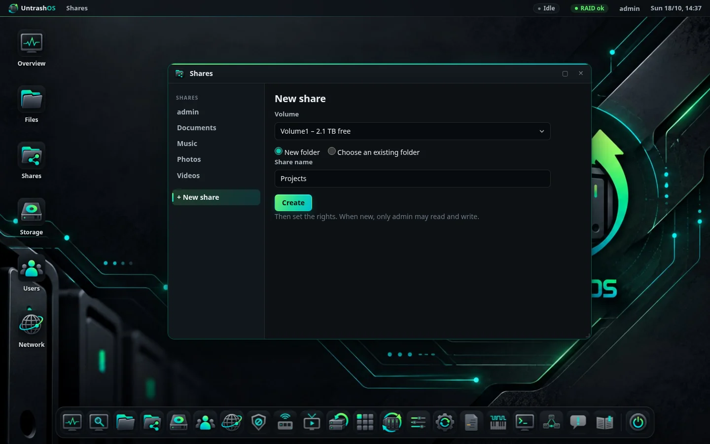

| Option | Choices | Meaning |
|---|---|---|
| Volume | the internal volumes with free space | Where the share lives. |
| Kind | **New folder**, Choose an existing folder | *Choose an existing folder* opens a folder browser; select the folder with **Choose this folder**. |
| Share name | text | Name in the network. |

A new share is readable and writable only by `admin`. Set its rights afterwards.

## 6. Storage

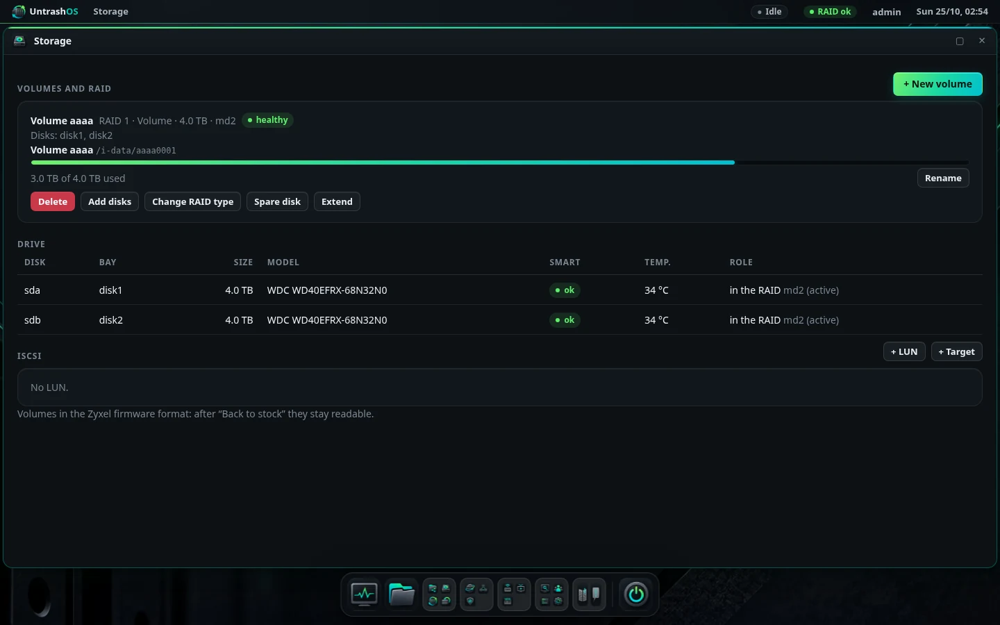

**Volumes and RAID** lists each array with its RAID type, size, disks, state (*healthy*,
*degraded*, *resyncing*, *failed*) and its volumes with their fill level. **Drive** lists every
disk with bay, size, model, SMART state, temperature and role (*in the RAID*, *free*,
*free (old data)*, *UntrashOS*, *USB*). All volumes are created in the format of the Zyxel firmware,
so the Zyxel firmware can still read them after the way back.

| Action | What it does | Confirmation |
|---|---|---|
| **+ New volume** | New array on free disks, see below. | `FORMAT` |
| **Rename** | New name for the volume. | — |
| **Add disks** | Extends the array with free disks; the RAID type stays. | `FORMAT` |
| **Change RAID type** | Moves to the next RAID type (for example RAID 1 → RAID 5) with additional disks. | `FORMAT` |
| **Spare disk** | Adds a hot spare that takes over when a disk fails. | `FORMAT` |
| **Repair** (only for degraded arrays) | Rebuilds the array onto a free disk. | `FORMAT` |
| **Extend** | After swapping all disks for larger ones: grows the array and file system to the new size. | — |
| **Delete** | Deletes the volume and every share on it. | `DELETE` |

The confirmation word protects the disks: everything on the selected disks, or on the deleted
volume, is lost. A running job is shown with its progress and log.

### New volume

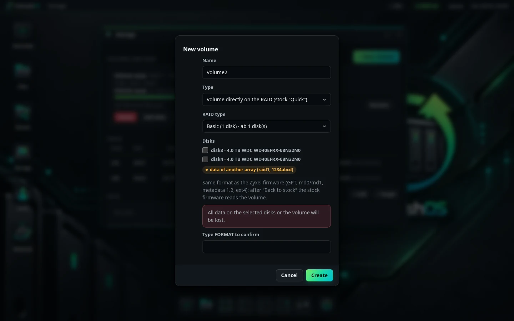

| Option | Choices | Meaning |
|---|---|---|
| Name | default **Volume2** | Name of the volume. |
| Type | **Volume directly on the RAID** (Zyxel “Quick”), Disk group with volumes (Zyxel “Expert”, LVM) | *Disk group* allows several volumes of chosen sizes on one array. |
| RAID type | **Basic** (1 disk), JBOD (from 2), RAID 0 (from 2), RAID 1 (from 2), RAID 5 (from 3), RAID 6 (from 4), RAID 10 (from 4) | Basic: one disk. JBOD: disks joined, no redundancy. RAID 0: striped, fast, no redundancy. RAID 1: mirrored. RAID 5: survives one failed disk. RAID 6: survives two. RAID 10: mirrored and striped. |
| Disks | the free disks | Which disks to use. |
| First volume: name, Size in GB | only for *Disk group*; empty size = everything | The first volume in the disk group. |

### iSCSI

Volumes can be offered to other computers as iSCSI disks.

| Dialog | Option | Meaning |
|---|---|---|
| **+ LUN** | Name, Volume, Size in GB | A virtual disk in a file on a volume. |
| | Thin (**on**) | Space is taken only when it is used. |
| | Write cache (**off**) | Faster, but data in the cache is lost on a power failure. |
| **+ Target** | Name, IQN (empty = automatic) | The address computers connect to. |
| | Only these initiators | Comma-separated IQNs that may connect; empty = all. |
| | CHAP, CHAP user name, CHAP password (12–16 characters) | Login required to connect. An empty password keeps the old one. |
| | Mutual CHAP, user name, password | The NAS also proves itself to the computer. |
| | Active (**on**) | Offers the target. |

## 7. Users and groups

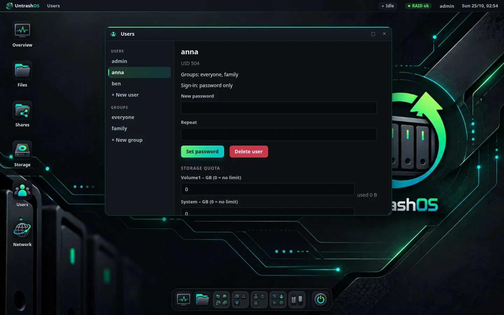

#### User page

| Option | Meaning |
|---|---|
| New password, Repeat | Sets the user's password (Desk, SMB, FTP, SSH for admin). |
| Delete user | Removes the account. `admin` cannot be deleted. |
| Storage quota | Per volume, in GB; **0** = no limit. The page shows how much the user already uses. |

#### + New user

| Option | Meaning |
|---|---|
| Name | Account name. |
| Description | Optional, for example the full name. |
| Password, Repeat password | At least 8 characters. |
| Groups | Groups the user joins. Every user is also in `everyone`. |

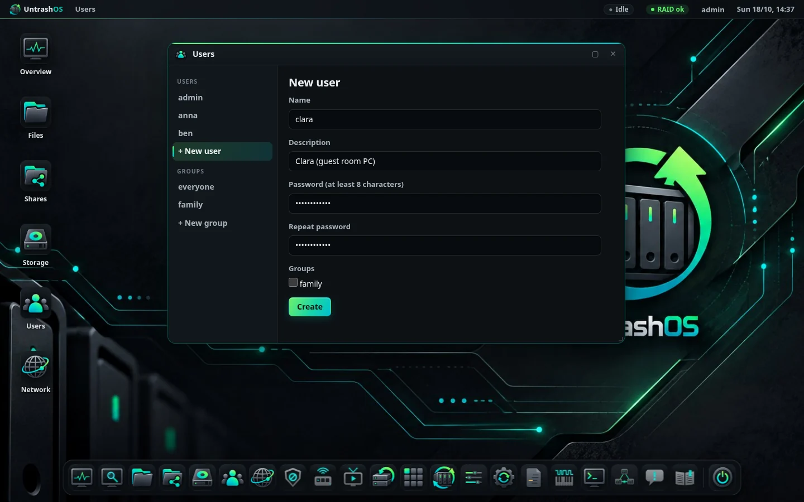

**Groups**: choose a group to tick its members and **Save**, or **Delete group**. **+ New group**
asks for a name and a description. Groups are used for share rights.

## 8. Network

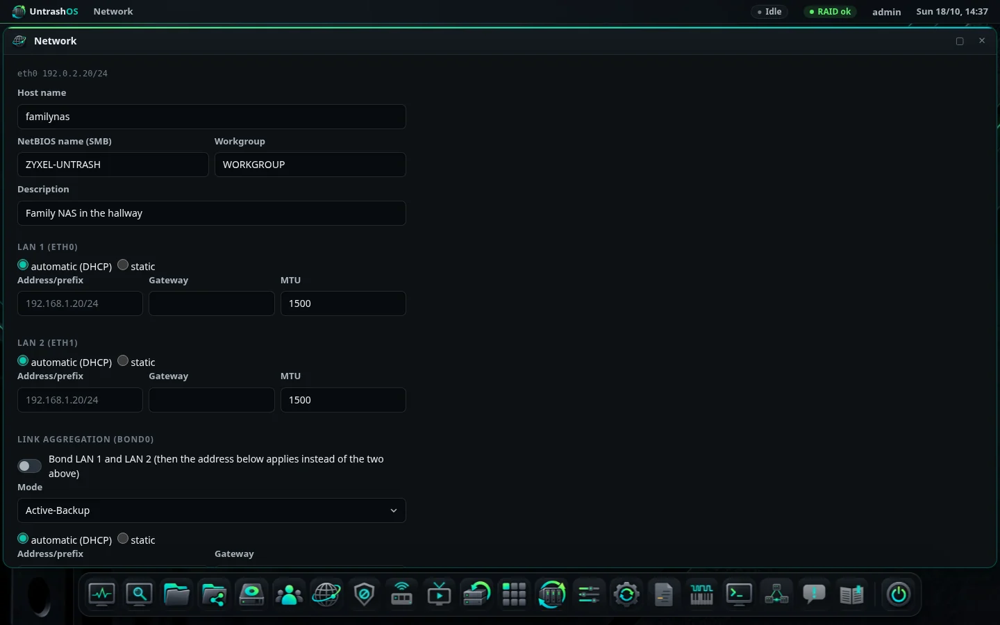

| Option | Choices | Meaning |
|---|---|---|
| Host name | default **untrash** (`untrash-2`, … if taken) | Name of the NAS in the network (`<host name>.local`). |
| NetBIOS name (SMB), Workgroup, Description | text | Name, workgroup and comment for Windows networking. |
| LAN 1 (eth0), LAN 2 (eth1) | **automatic (DHCP)**, static | With *static*: Address/prefix (address and prefix length, for example `<LAN_IP>/24`), Gateway. MTU default **1500**. |
| Link aggregation (bond0) | **off**, on | Bonds both ports. The address of the bond then applies instead of the two above. |
| Bond mode | Round-Robin, **Active-Backup**, XOR, Broadcast, 802.3ad (LACP, switch required), Adaptive transmit load balancing, Adaptive load balancing | *Active-Backup* works with every switch and gives fail-over. *802.3ad* needs a switch that supports LACP. |
| DNS | **from the DHCP server**, or DNS 1 and DNS 2 | Name servers of the NAS. |

**Save and apply** activates the settings. A wrong static address makes the NAS unreachable. The
way back: connect the NAS directly to a PC with a network cable. It is then reachable by its
automatic address as `<host name>.local`.

**Router (UPnP port forwarding)** opens ports on the router for access from the internet. For each
service enter a WAN port (empty = off): Untrash Desk (HTTP), Untrash Desk (HTTPS), FTP, SSH,
WebDAV, WebDAV (HTTPS), Web Publishing, media server. The table shows what the router currently
forwards. **Forwarded services are reachable from the internet.** Use HTTPS and strong passwords.

## 9. Settings

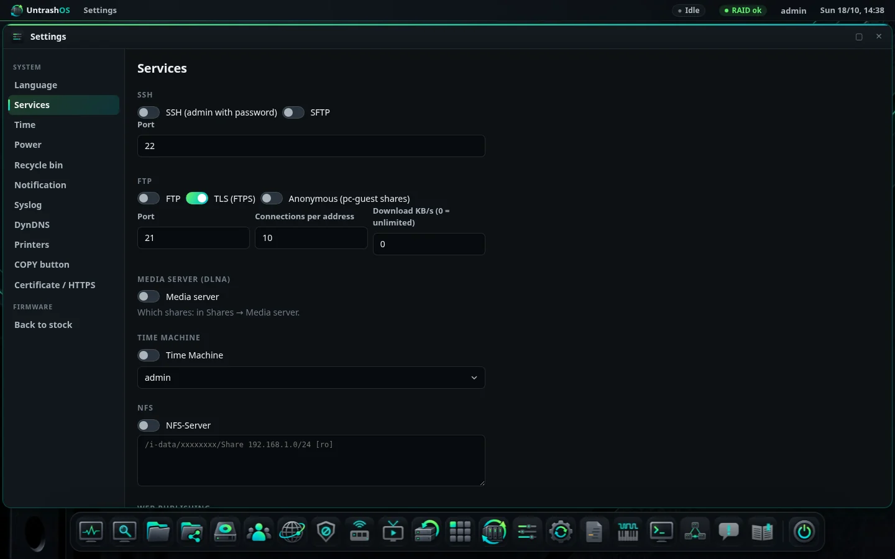

### Language

| Option | Choices | Meaning |
|---|---|---|
| System language | **English**, Deutsch, Français | For everyone who has not chosen a language in their browser. |
| Language of this browser | **— as system —**, English, Deutsch, Français | Only for the browser you are using. |

### Services

| Option | Choices | Meaning |
|---|---|---|
| SSH (admin with password) | **off**, on | Shell access for `admin`. Port default **22**. |
| SFTP | **off**, on | File transfer over SSH. |
| FTP | **off**, on | FTP server. Port **21**. |
| TLS (FTPS) | **on**, off | Encrypted FTP. Uses the certificate from *Certificate / HTTPS*. |
| Anonymous (pc-guest shares) | **off**, on | FTP without login for the guest shares. |
| Connections per address | default **10** | Limit per client. |
| Download KB/s | **0** = unlimited | Speed limit for FTP downloads. |
| Media server | **off**, on | DLNA/UPnP server ([section 11](#11-media-server-and-channels)). |
| Time Machine | **off**, on, with a share | Backup target for Macs. |
| NFS server | **off**, on | One export per line: `/i-data/<volume>/<share> <network>/<prefix> [ro]`. |
| Web Publishing | **off**, on; Port **80** | Shares marked for Web Publishing under `http://<NAS>/MyWeb/<share>`. |
| WebDAV | **off**, on; Anonymous (guest shares) **off** | `http://<NAS>:5002/webdav/<share>`, HTTPS on port 5003. Same rights as the share. |

**Save and apply** restarts the changed services.

### Time

| Option | Choices | Meaning |
|---|---|---|
| Time zone | all time zones, default **Europe/Berlin** | Local time of the NAS. |
| Time from the network (NTP) | **on**, off | Sets the clock automatically. NTP server default **pool.ntp.org**. |

### Power

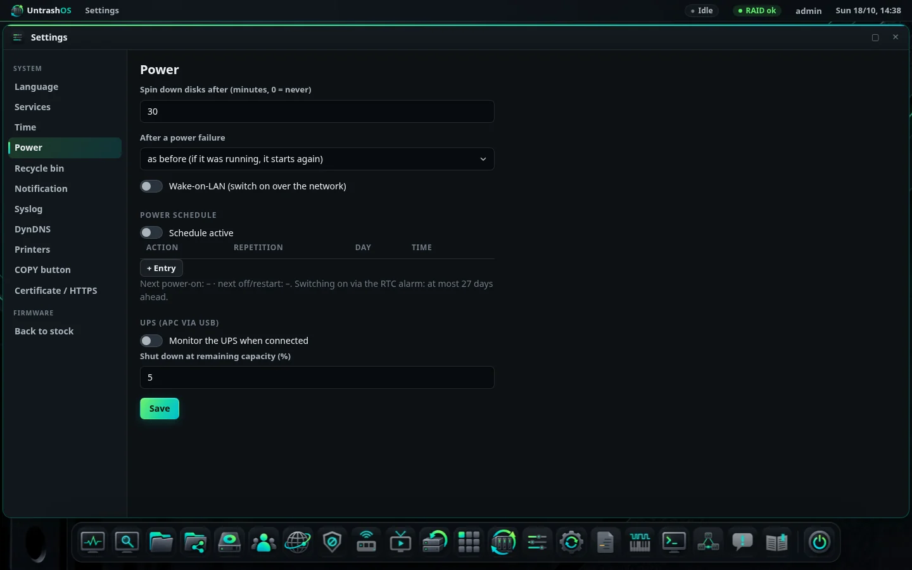

| Option | Choices | Meaning |
|---|---|---|
| Spin down disks after | minutes, **0** = never | Idle disks stop spinning. |
| After a power failure | **as before** (if it was running, it starts again), always switch on, stay off | Behaviour when the power returns. |
| Wake-on-LAN | **off**, on | Switch the NAS on with a network packet. |
| Power schedule | **off**, on; entries with Action (switch on, **switch off**, restart), Repetition (**daily**, weekly, monthly), Day, Time | Switches the NAS on and off by the clock. The page shows the next planned events. Switching on uses the alarm clock of the NAS, which reaches at most 27 days ahead. |
| Monitor the UPS when connected | **off**, on | For an APC UPS on USB. |
| Shut down at remaining capacity | % , default **5** | The NAS shuts down cleanly when the UPS battery reaches this level. |

### Recycle bin

| Option | Choices | Meaning |
|---|---|---|
| Delete permanently after days | **0** = never | Files in the `recycle` folders are deleted after this many days. Shares need *Recycle bin* switched on ([section 5](#5-shares)). |

### Notification

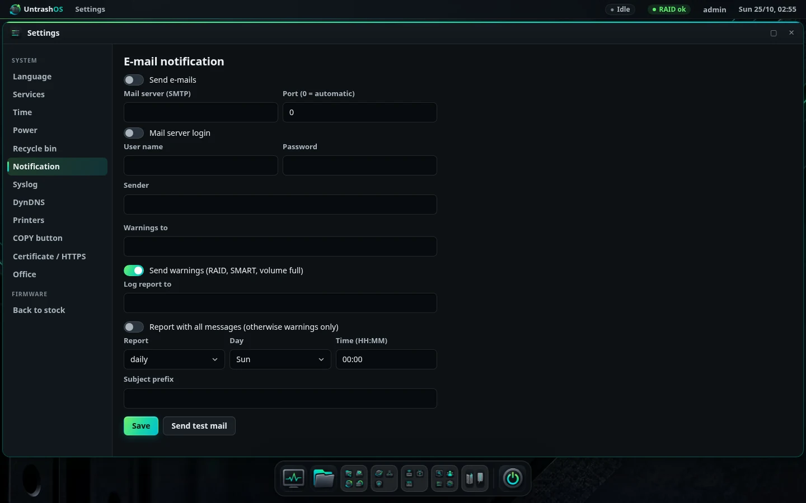

| Option | Choices | Meaning |
|---|---|---|
| Send e-mails | **off**, on | Switches e-mail sending on. |
| Mail server (SMTP), Port | Port **0** = automatic | Your provider's outgoing mail server. |
| Mail server login | **off**, on; User name, Password | Most providers require a login. |
| Sender | address | From-address of the e-mails. |
| Warnings to | address | Receives warnings. |
| Send warnings (RAID, SMART, volume full) | **on**, off | Sends an e-mail at once when one of these occurs. |
| Log report to | address | Receives regular log reports. |
| Report with all messages | **off** (warnings only), on | Content of the report. |
| Report | hourly, **daily**, weekly; Day (for weekly); Time **00:00** | When the report is sent. |
| Subject prefix | text | Put in front of every subject, to sort the e-mails. |

**Send test mail** checks the settings.

### Syslog

| Option | Choices | Meaning |
|---|---|---|
| Forward | **off**, on; Server, Port (UDP) **514** | Sends the NAS log to a syslog server. |
| Syslog server on port 514 | **off**, on | Collects the logs of other devices on the NAS. |
| Share, Folder | default folder **syslog** | Where collected logs are stored. |
| Format | **simple** (date, device, message), complete | Line format. |
| Keep months | default **6** | Older logs are deleted. |

### DynDNS

| Option | Choices | Meaning |
|---|---|---|
| Keep the address current at the DynDNS provider | **off**, on | Updates a host name when your internet address changes. |
| Provider | **DynDNS (dyn.com)**, No-IP, 3322.org, ZoneEdit, Duck DNS, FreeDNS (afraid.org), dynv6 | Your DynDNS service. |
| Host name, User name, Password / token | text | Your account at the provider. |

### Printers

| Option | Choices | Meaning |
|---|---|---|
| Share USB printers on the network (SMB and IPP) | **on**, off | Connected USB printers get a queue without a driver; the computer that prints brings the driver. The page lists known printers and their jobs. |

### COPY button

The COPY/SYNC button on the front of the NAS works with the most recently connected USB drive.
**Short press = copy, hold 3 seconds = synchronize.**

| Option | Choices | Meaning |
|---|---|---|
| Copy: NAS share | **– none –**, every share | Share used for copying; *none* switches the short press off. |
| Copy: Direction | **USB → NAS**, NAS → USB | |
| Keep replaced files in | **– do not keep –**, every share | Files that a copy would overwrite are kept there. |
| Copy into a new (dated) folder | **on**, off | Every copy goes into its own folder named by date. |
| Synchronize: NAS share | **– none –**, every share | Share used for synchronizing; *none* switches the long press off. |
| Synchronize: Direction | **both directions**, NAS → USB (mirror), USB → NAS (mirror) | *Mirror* makes the target equal to the source and deletes what is not in the source. |
| Keep replaced/deleted files in | **– do not keep –**, every share | Safety copy of overwritten or deleted files. |

**Copy now** and **Synchronize now** do the same as the button.

### Certificate / HTTPS

| Option | Meaning |
|---|---|
| Name (CN), Create a self-signed certificate | Creates a certificate for the given name. Browsers warn about self-signed certificates once. |
| Own certificate | Paste your certificate (with intermediate certificates) and the unencrypted private key, then **Upload**. |
| HTTPS (**off**), Port **443** | Serves the Desk over HTTPS. |
| Redirect HTTP to HTTPS (**off**) | Sends every browser to HTTPS. |

The certificate is also used for FTPS and WebDAV over HTTPS. **Save** restarts the Desk.

### Back to stock

See [section 18](#18-back-to-the-zyxel-firmware).

## 10. Ad filter

The ad filter blocks ads and trackers for every device in the home network that uses the NAS as
its DNS server.

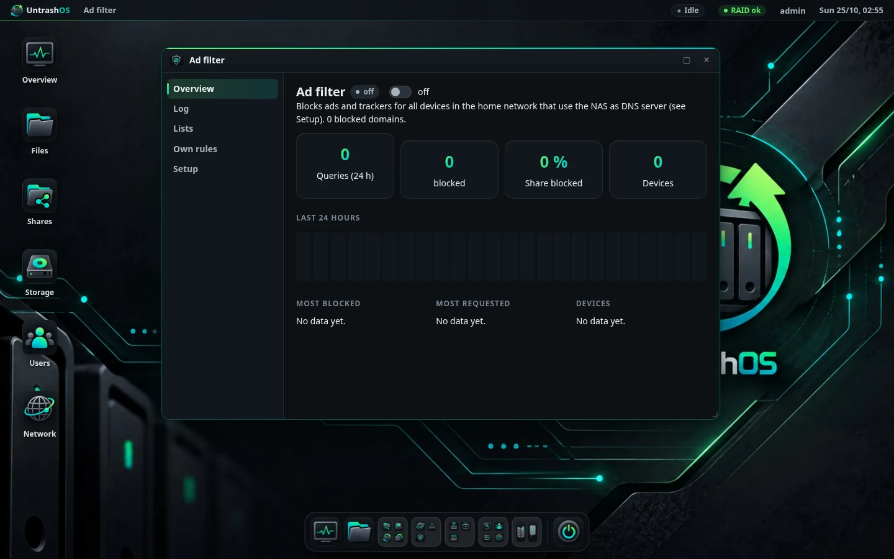

| Page | Content and options |
|---|---|
| **Overview** | Switch **on/off**; queries and blocked queries in the last 24 hours, share blocked, devices; a chart of the last 24 hours; most blocked and most requested domains; the devices. |
| **Log** | Single queries. *Filter by domain or device*, **blocked only** (off). Each entry can be **allowed** or **blocked** directly. |
| **Lists** | The block lists in use, each can be switched on/off or removed. Built in: StevenBlack (**on**), Hagezi Light, Hagezi Pro (stricter). Add your own list with *Name* and *List address* (hosts or domain format). **Update now** reloads the lists; they also reload every week. |
| **Own rules** | *Always allow* and *Always block*, one domain per line. A blocked domain includes all its subdomains. *Always allow* wins over the lists. |
| **Setup** | How to make the devices use the NAS as DNS server, see below. |

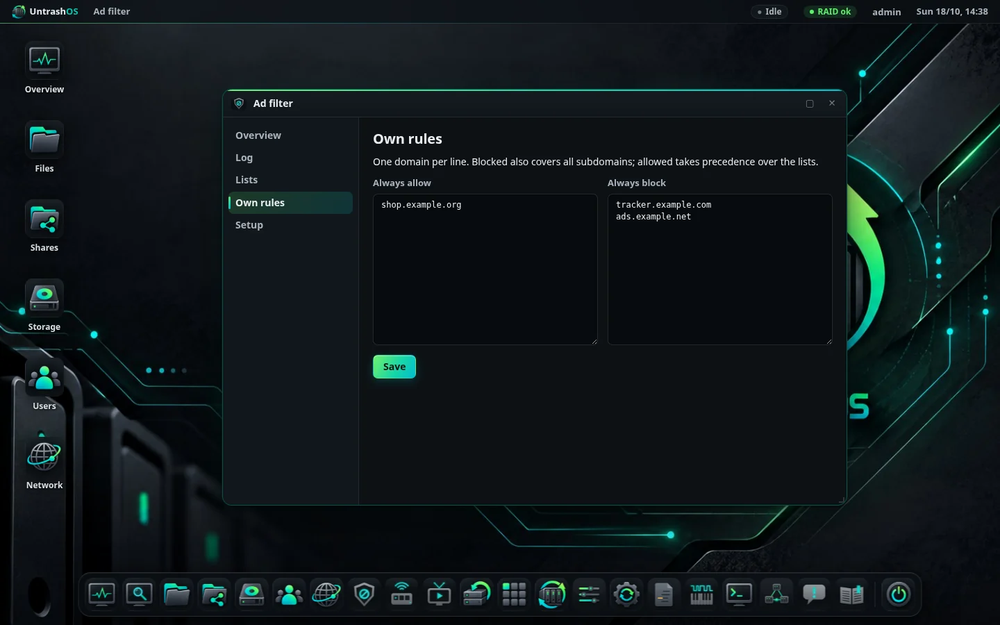

**Setup in short:** in the router, enter the address of the NAS as the *local DNS server* (on a
FRITZ!Box: Home Network → Network → Network Settings → IPv4 Settings). Then reconnect the devices.
The NAS needs a fixed address for this (in the router: "always assign the same IPv4 address", or a
static address in [section 8](#8-network)). While the NAS is off, devices cannot resolve names until
the router falls back to its own DNS, and some routers do not. Single devices can also be switched
in their own network settings.

More lists block more, but also more likely something you want. Then add that domain to *Always
allow*.

## 11. Media server and channels

### Media server

The media server (DLNA/UPnP) makes videos, music and photos available to TVs, consoles, VLC and
Kodi. It appears in the network under the host name of the NAS.

| Page | Content and options |
|---|---|
| **Status** | State (on/off); number of videos, songs and photos; devices that asked; current playbacks; **Rescan** reads all shares again. |
| **Shares** | Per share: Video, Photos, Music. Empty or missing folders are not published. (The same as in [Shares](#5-shares).) |
| **Channels** | The channels, see below. |
| **Settings** | *Media server on* (**off**); *Channels receivable in the home network without signing in* (**on**, for TVs, VLC, Kodi). |

### Channels

A channel works like a TV station: it plays its playlist endlessly by the clock, and everyone who
tunes in sees the same thing. The NAS converts a channel only once, however many people watch it,
and at most 2 channels at the same time. A channel starts with its first viewer and pauses one
minute after the last one leaves.

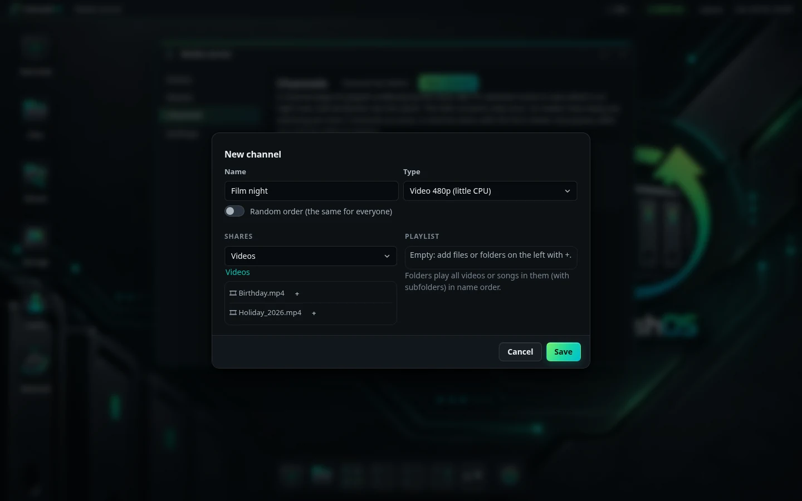

| Option | Choices | Meaning |
|---|---|---|
| Name | text | Name of the channel. |
| Type | **Video 480p (little CPU)**, Video 720p (more CPU), Video unchanged (H.264 only, hardly any CPU), Radio (sound only) | Picture quality versus load on the NAS. |
| Random order | **off**, on | Shuffles the playlist, the same way for every viewer. |
| Shares / Playlist | files and folders of the shares | Add videos, music or whole folders (**+**). Folders play everything inside them, including subfolders, in name order. Reorder with **↑**, remove with **✕**. |

Everyone watches in the **Channels** app (also in the dock of normal users). The list of channels
is also available as an M3U playlist for VLC and Kodi (*Channel list (M3U)*).

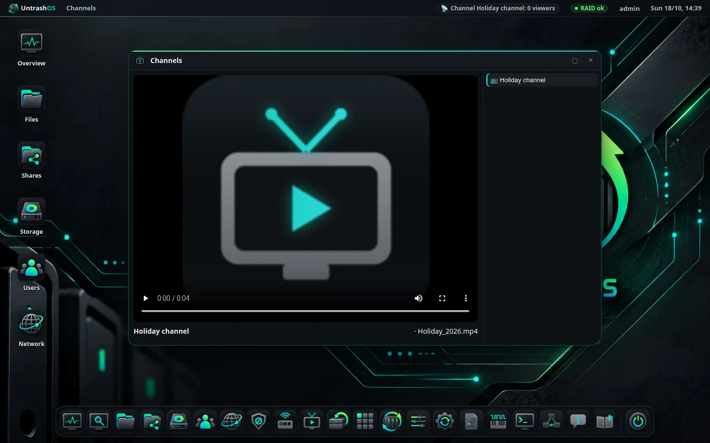

## 12. Cloud

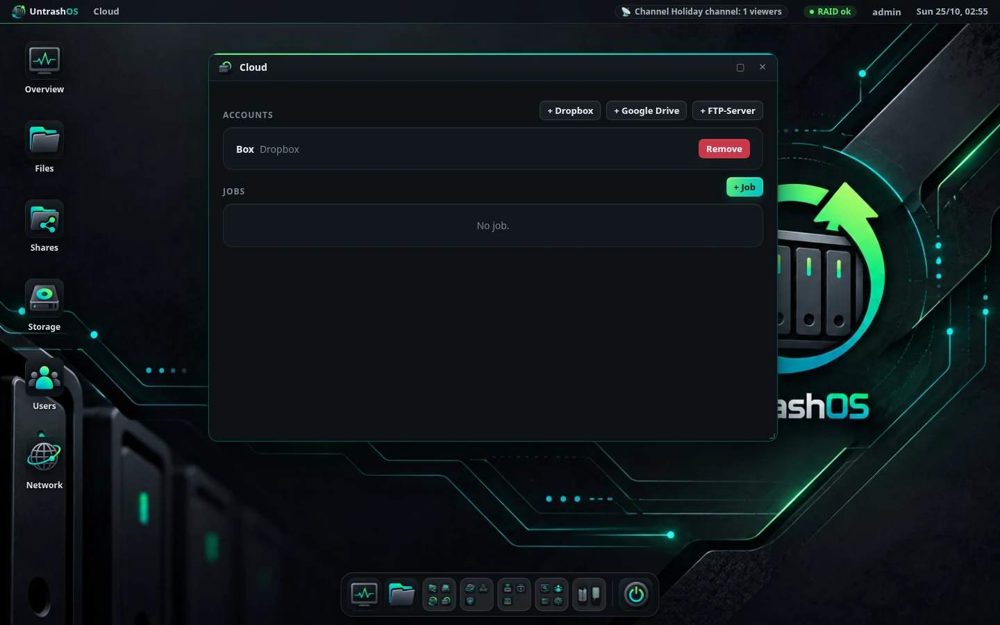

#### Accounts

| Button | Options | Meaning |
|---|---|---|
| **+ Dropbox**, **+ Google Drive** | Account name | Click **Open the sign-in page**, sign in and agree. The browser then shows an error page under `localhost:53682`; this is expected. Copy the complete address of that page into *Redirect address* and click **Done**. |
| **+ FTP server** | Name, Server, Port **21**, User name, Password, TLS (explicit) **off** | An FTP server as target. |
| **Remove** | | Removes the account. Files stay. |

#### Jobs (+ Job)

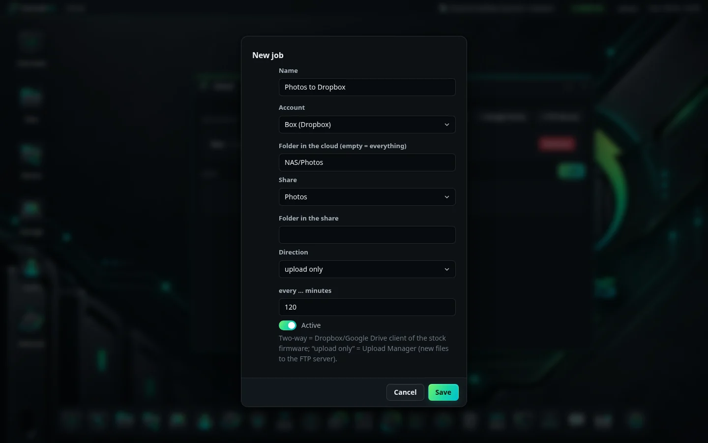

| Option | Choices | Meaning |
|---|---|---|
| Name | default **Sync** | Name of the job. |
| Account | the connected accounts | |
| Folder in the cloud | empty = everything | |
| Share, Folder in the share | | The local side. |
| Direction | **two-way sync**, upload only, download only | *Two-way* works like the Dropbox/Google Drive client of the Zyxel firmware. *Upload only* works like its Upload Manager (new files go to the cloud or FTP server). |
| every … minutes | default **60** | How often the job runs. |
| Active | **on**, off | |

## 13. Downloads

The download service loads files over HTTP, FTP, BitTorrent and magnet links into a share.

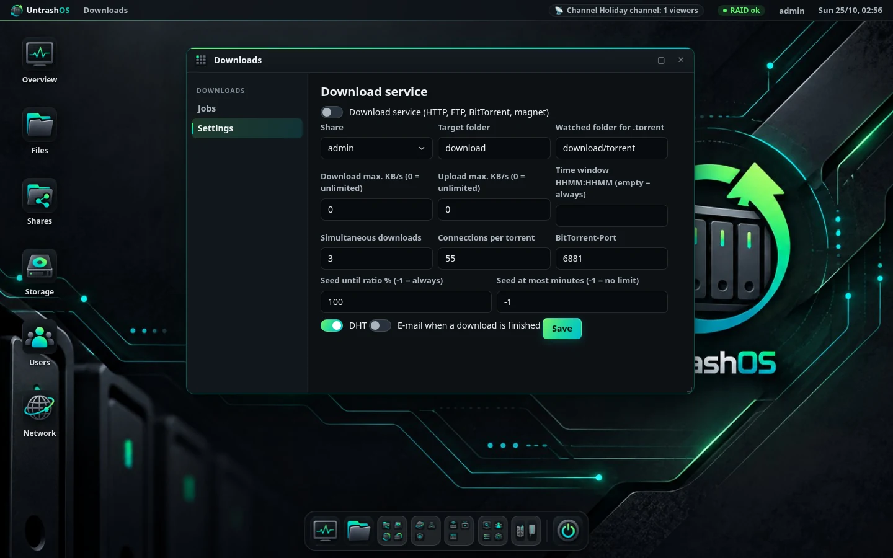

**Jobs** lists the downloads with their progress. Add a download by its address (http, ftp or
magnet) with **Add**, or upload a `.torrent` file. Downloads can be paused, resumed and removed;
*Finished ones from the list* clears the list.

#### Settings

| Option | Choices | Meaning |
|---|---|---|
| Download service | **off**, on | Switches the service on. |
| Share, Target folder | default folder **download** | Where downloads are saved. |
| Watched folder for .torrent | default **download/torrent** | `.torrent` files put there start automatically. |
| Download max. KB/s, Upload max. KB/s | **0** = unlimited | Speed limits. |
| Time window | `HHMM:HHMM`, empty = always | Downloads run only in this time, for example `0100:0700`. |
| Simultaneous downloads | default **3** | |
| Connections per torrent | default **55** | |
| BitTorrent port | default **6881** | |
| Seed until ratio % | default **100**; -1 = always | Upload share after a torrent is complete. |
| Seed at most minutes | default **-1** = no limit | |
| DHT | **on**, off | Finds peers without a tracker. |
| E-mail when a download is finished | **off**, on | Needs [e-mail notification](#notification). |

## 14. Backup

**+ Backup** creates a backup job. The list shows each job with type, target, schedule and last run.
Each job can be started at once (**Now**), edited or deleted. **Restore** copies a backup back.

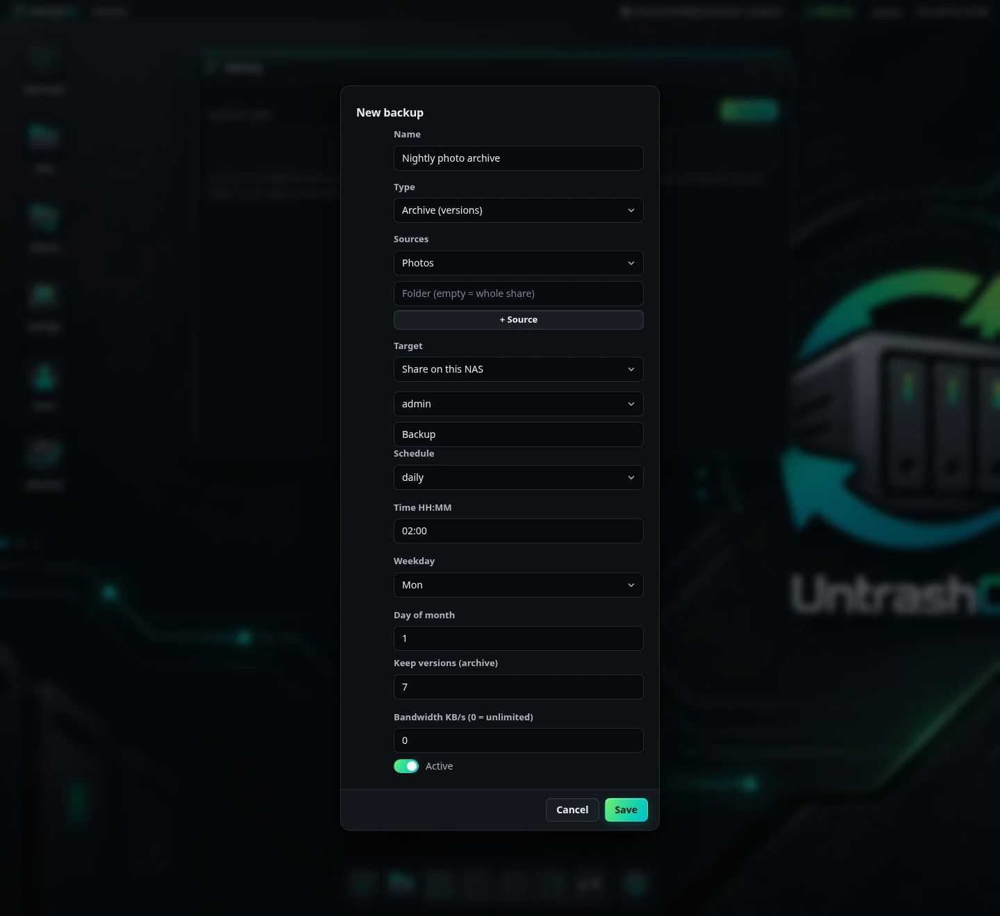

| Option | Choices | Meaning |
|---|---|---|
| Name | text | |
| Type | **Archive (versions)**, Synchronization (mirror), Rsync server | *Archive*: one dated folder per run, unchanged files take no extra space. *Synchronization*: the target becomes a mirror of the source. *Rsync*: to an rsync server (another NAS or computer). |
| Sources | shares, each with an optional folder (empty = whole share); **+ Source** adds more | What is backed up. |
| Target | **Share on this NAS** (share and folder), connected **USB** drives | Where it goes (archive and synchronization). |
| Rsync server, Module, User name, Password | only for *Rsync server* | The rsync target. An empty password keeps the saved one. |
| Schedule | manual only, hourly, **daily**, weekly, monthly; Time **02:00**; Weekday; Day of month | When the job runs. |
| Keep versions (archive) | default **7** | Older versions are deleted. |
| Bandwidth KB/s | **0** = unlimited | Limits the speed. |
| Active | **on**, off | Off keeps the job without running it on schedule. |

**Restore** (archive and synchronization jobs): choose a version, the share to restore into and a
folder (default *Restored*). The backup is copied into that folder.

## 15. Updates

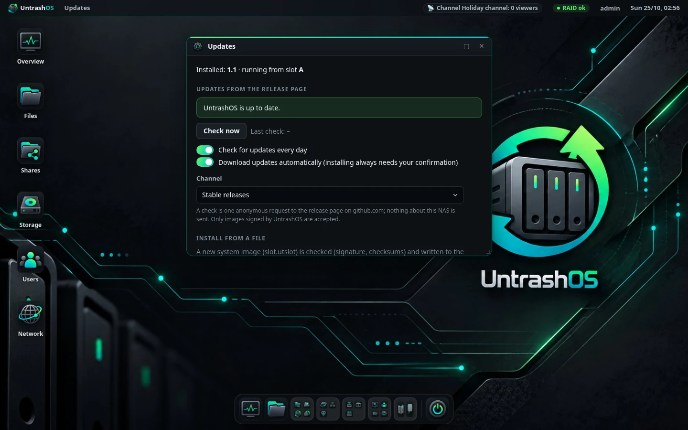

The page shows the installed version and the system slot it runs from (A or B).

### Updates from the release page

Once a day the NAS looks on the release page of this project (on github.com) for a newer
UntrashOS for this device, downloads it and checks it (signature, checksums). Nothing is installed
on its own: when an update is ready, admins see a note after signing in, and the Updates page shows
the new version with its release notes.

1. Click **Install UntrashOS x.y** and confirm: the image is written to the **other** slot.
2. Click **Restart now** (or restart later).

| Setting | Values | Meaning |
|---|---|---|
| Check for updates every day | **on** / off | **Check now** works either way. |
| Download updates automatically | **on** / off | Off: the page shows the new version with a **Download** button. |
| Channel | **Stable releases**, Beta (pre-releases too) | Beta also offers test versions before a release. |

A check is one anonymous request to github.com; nothing about the NAS is sent. Only images signed by
UntrashOS are accepted, and only versions newer than the running one are offered.

### Install from a file

1. Click **Choose a system image …** and select an update file (`untrash-…-update.utslot`). A stick
   image (`.img`) is refused.
2. The file is uploaded (with progress) and checked: signature and checksums.
3. Click **Install**: the image is written to the **other** slot. An image that is not newer than
   the running system needs **Install the older version anyway**.
4. Click **Restart now**.

Either way: if the new system does not start cleanly, the loader goes back to the current one by
itself. Your settings and data are not part of the slot and stay as they are.

## 16. Status, logs and system tools

**Status** is updated every two seconds:

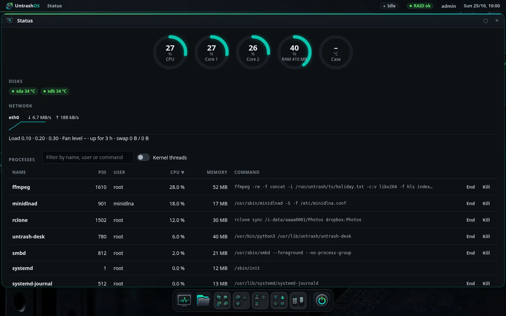

| Element | Meaning |
|---|---|
| Rings | CPU in total and per core, memory, case temperature. Colours change at warning levels. |
| Disks | Temperature of each disk. Sleeping disks are shown as asleep and are not woken up. |
| Network | Current traffic per port. |
| Bottom line | Load, fan level, uptime, swap in use. |

**Logs** shows the system log or the log of a single service: System, SMB, Volumes, Takeover (the
first start after way B), SSH, FTP, Media server, Desk.

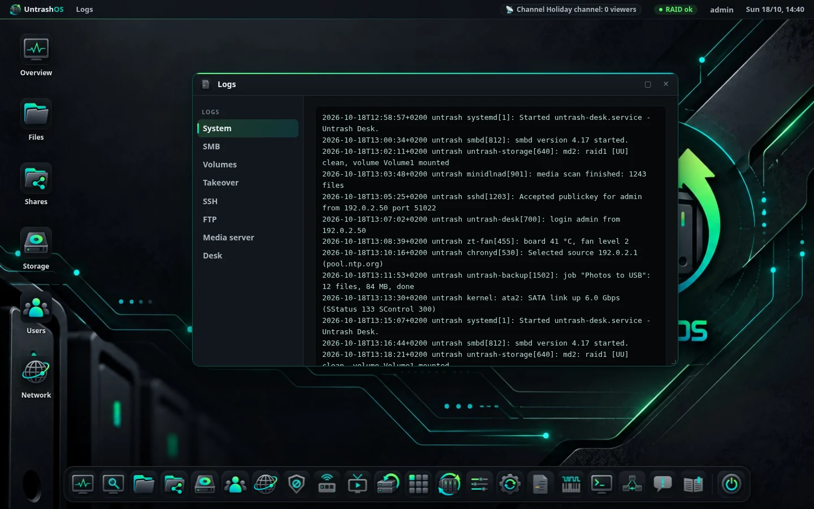

**Sounds** edits the melodies the NAS buzzer plays for events: Start, Shut down, Error, Critical,
Success, Device connected, Device disconnected, Warning, Standby. Events you changed are marked ★.

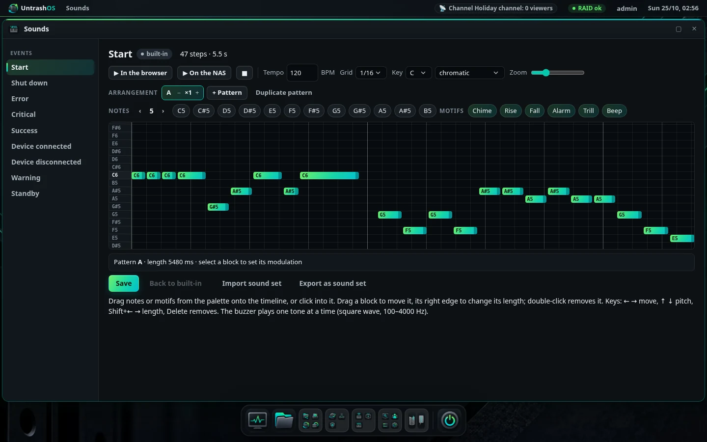

The editor works like a small loop-based music program. The buzzer plays one tone at a time
(square wave, 100–4000 Hz), so blocks on the timeline never overlap.

| Part | Meaning |
|---|---|
| ▶ In the browser, ▶ On the NAS, ■ | Plays the whole melody, or stops it. The browser plays exactly what the buzzer plays. |
| Tempo | Beats per minute (40–300). Changing it makes the melody faster or slower; its shape stays. |
| Grid | Note lengths snap to 1/8, 1/16 or 1/32 of a bar. |
| Key, scale | The rows of the timeline: only the notes of this key and scale (major, minor, pentatonic, minor pentatonic, blues, chromatic). Older melodies open in the key that holds all their notes. |
| Arrangement | The order of the patterns, each with its number of repeats (**−**, **+**). **◀** moves a pattern earlier, **✕** takes it out. **+ Pattern** adds an empty one, **Duplicate pattern** a copy of the pattern you edit. Click a pattern's name to edit it. |
| Notes, Motifs | Drag a note (choose the octave with **‹ ›**) or a motif (Chime, Rise, Fall, Alarm, Trill, Beep) onto the timeline. |
| Timeline | Click an empty place for a new note. Drag a block to move it in time and pitch, drag its right edge to change its length, double-click to remove it. The orange line is the end of the pattern; drag it to leave a rest before the next repeat. Keys: **← →** move, **↑ ↓** pitch, **Shift + ← →** length, **Delete** removes, **Ctrl + D** duplicates. |
| Block below the timeline | Note, length and **modulation** of the selected block: *Staccato* (short, with a gap), *Vibrato* (depth, rate), *Slide* (glide by up to two octaves), *Fall* (drops an octave at the end), *Arpeggio* (major, minor, fifth or octave chord, speed). |
| Save, Back to built-in | Saves your melody (at most 60 s), or returns to the original. |
| Import sound set, Export as sound set | Loads or saves all melodies as a JSON file; the editor's patterns are part of it. |

**Terminal** (administrators only) opens a shell on the NAS in the browser window.

**UntrashMesh** is a preview of a coming feature: several UntrashOS devices form one encrypted
network for mirrored shares, mutual off-site backups and access on the road. It will arrive with
an update.

**Feedback** prepares a bug report or a suggestion as a GitHub issue. Nothing is sent
automatically.

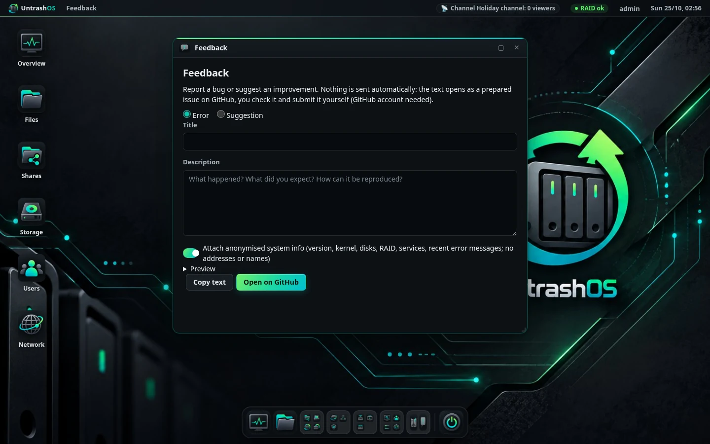

| Option | Choices | Meaning |
|---|---|---|
| Kind | **Error**, Suggestion | |
| Title, Description | text | What happened, what you expected, how to reproduce it. |
| Attach anonymised system info | **on**, off | Version, kernel, disks, RAID, services and recent error messages, without addresses or names. **Preview** shows exactly what is attached. |
| Copy text, Open on GitHub | | Copies the text, or opens it as a prepared issue on GitHub. You check it and submit it yourself (GitHub account needed). |

**Manual** shows this guide inside the Desk, with **Open in a new tab** and **Download PDF**:

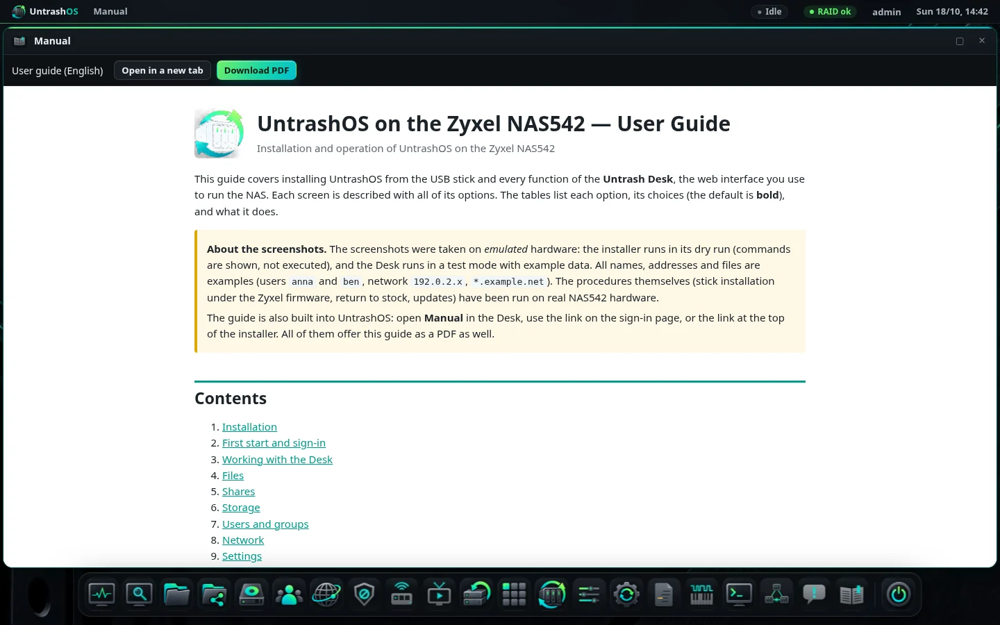

**Power button** (end of the dock): **Run** switches the NAS off. With *Restart instead* it
restarts. All connections are closed.

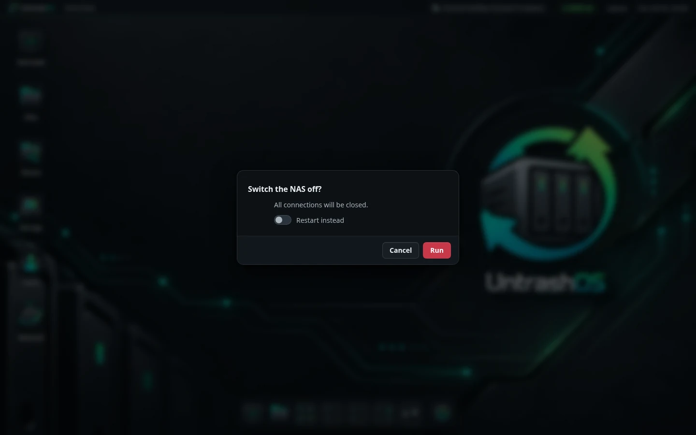

**Your user name** (top bar) opens **Account**: change the *language of this browser* (— as system —,
English, Deutsch, Français), the **Appearance**, or **Sign out**.

**Appearance** belongs to your user: it is stored on the NAS and follows you to every browser you
sign in with. It applies at once.

| Setting | Values | Meaning |
|---|---|---|
| Theme | Automatic (as the system), **Dark**, Light, High contrast | *Automatic* follows the light/dark and "more contrast" setting of your computer or phone. *High contrast*: black background, white text, strong borders, no transparency or wallpaper. |
| Colour vision | **Normal colour vision**, Red-weak (protanopia), Green-weak (deuteranopia), Blue-weak (tritanopia), No colour vision (achromatopsia) | Other colours for states (healthy, warning, error, information) that stay apart for that kind of colour vision, plus a symbol on each state (✓ ! ✕ i) and stripes on warning and error bars, so that nothing depends on colour alone. |
| Reduce motion | **off** / on | No animations (also on when your system asks for reduced motion). |

## 17. Working as a normal user

Users who are not administrators see a smaller Desk: **Files**, **Channels**, **Manual** and
**My account**. They see only the shares they have rights to and can only change what those rights
allow.

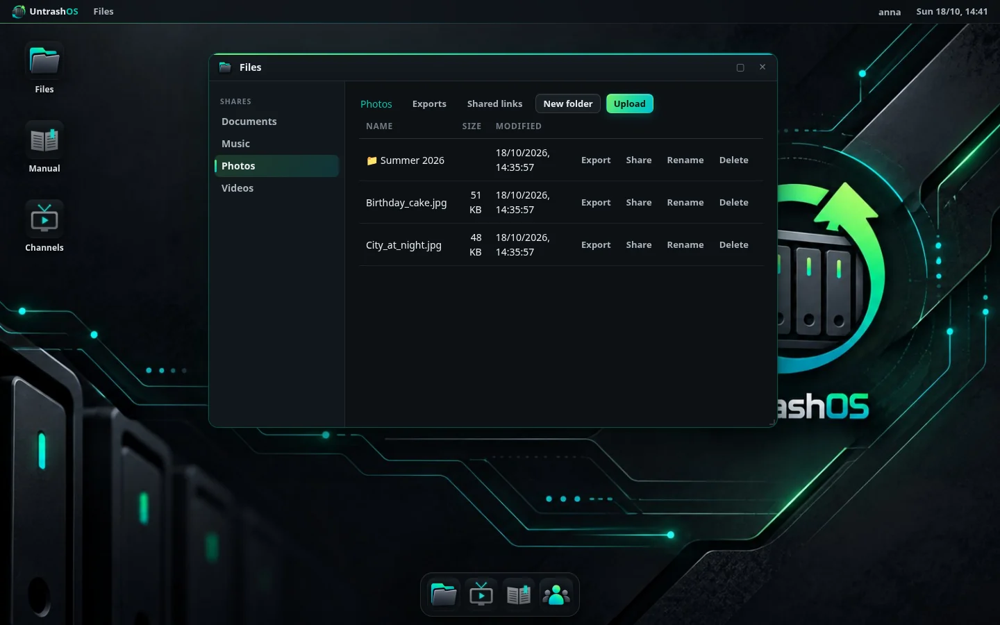

**My account**: *Current password*, *New password*, *Repeat*, then **Change password**. **Sign out**
ends the session. **Appearance** below works as described in [section 3](#3-working-with-the-desk).

## 18. Back to the Zyxel firmware

UntrashOS can always go back to the original Zyxel firmware with the backup on the installation
stick. Data on the disks stays. The UntrashOS files in `/.untrash` (ways B and C) or the UntrashOS
disk (way A) are left in place, so you can return to UntrashOS later.

**From the Desk:** plug in the installation stick, open **Settings → Back to stock**. The page shows
the backup found on the stick. Type `STOCK` and click **Back to the Zyxel firmware**.

**From the installer** (if UntrashOS does not start any more): start the NAS with the installation
stick and choose [way D](#15-the-four-ways).

Both ways then do the same:

1. The backup is checked against its checksums, and the stick gets the `ROLLBACK` order.
2. The NAS restarts and runs the Zyxel firmware once. The firmware writes its boot data back from
   the backup and switches the NAS off after a few minutes. Leave the stick in.
3. Switch the NAS on: it starts the Zyxel firmware as before the installation.
